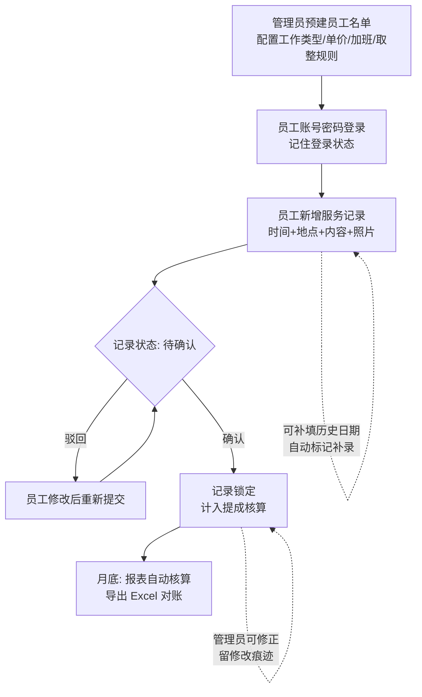

# 工程师上门服务记录与提成核算系统 —— 需求文档

| 文档信息 | 内容 |
|---|---|
| 文档版本 | V1.0 |
| 编写日期 | 2026-11-09 |
| 文档状态 | 需求已梳理闭环，待开发 |
| 产品形态 | H5 网页（手机浏览器 / 微信内置浏览器 / PC 浏览器自适应） |

---

## 1. 项目背景与目标

### 1.1 现状与痛点

工程师上门服务（送货、安装、维修等）目前采用**纸质《工作记录表》手工记录**，月末由管理员统一人工汇总，用于提成核算。存在以下问题：

1. 纸质记录零散，月底汇总费时费力；
2. 手工统计易出错，且难以追溯核对，提成结算缺乏客观依据；
3. 计费规则复杂（按次 / 按小时 / 18 点后加班双倍），人工计算口径容易不统一，容易产生争议；
4. 记录无照片、无定位留痕，真实性无法佐证。

### 1.2 项目目标

建设一套 **H5 移动端服务记录与提成核算系统**，实现：

- **工程师**：手机上随手记录"什么时间、去哪、干了啥"，支持拍照与自动定位留痕；
- **管理员**：审核确认记录，月底一键生成提成报表并导出 Excel，核算口径由系统统一固化。

### 1.3 业务价值

记录线上化 → 留痕可查 → 审核把关 → 系统自动核算 → 月底导出对账，全程闭环，替代纸质表。

---

## 2. 名词定义

| 名词 | 定义 |
|---|---|
| 服务记录 | 一次上门服务的事实记录：日期时间、地点、工作内容、照片、定位等 |
| 工作类型 | 服务内容的分类（如送货、安装、维修），是计费模式与定价的载体 |
| 计费模式 | 分两类：**按次**（送货上门类，按次数计费）、**按小时**（按服务时长计费） |
| 加班时段 | 按小时计费的记录中，结束时间落在加班起算时间之后的部分 |
| 单价矩阵 | 按"工程师 × 工作类型"组合设定的单价表 |
| 待确认 / 已确认 / 已驳回 | 记录的三种审核状态 |
| 补录 | 员工对非当日日期补填的记录，系统自动打标 |

---

## 3. 用户角色与权限

系统共 **2 个角色**，单管理员（不做多管理员）。

### 3.1 角色定义

| 角色 | 说明 | 使用设备 |
|---|---|---|
| 员工（工程师） | 记录自己的上门服务，查看本人历史记录与当月提成汇总 | 手机 H5 为主 |
| 管理员 | 维护名单与计费配置，审核记录，统计核算与导出 | 手机 H5 审批看报表；PC 浏览器导出 Excel |

### 3.2 权限矩阵

| 功能 | 员工 | 管理员 |
|---|:---:|:---:|
| 新增自己的服务记录 | ✓ | —（不代填） |
| 修改 / 删除自己的记录（本人未确认前） | ✓ | — |
| 查看自己的记录列表与当月汇总 | ✓ | ✓ |
| 查看全部员工记录 | — | ✓ |
| 审核确认 / 驳回记录 | — | ✓ |
| 修正已确认记录（留痕） | — | ✓ |
| 员工名单管理（增删改、停用、重置密码） | — | ✓ |
| 工作类型管理 | — | ✓ |
| 单价矩阵配置 | — | ✓ |
| 加班规则 / 取整规则配置 | — | ✓ |
| 月度报表查看 | — | ✓ |
| 导出 Excel | — | ✓ |
| 修改本人登录密码 | ✓ | ✓ |

---

## 4. 总体业务流程

**流程要点：**

1. 员工提交后记录为「待确认」，**管理员确认前员工可自行修改或删除**；
2. 管理员**驳回**后记录回到员工可编辑状态，员工修改后重新提交（重走审核）；
3. 管理员**确认**后记录锁定，计入提成；仅管理员可修正，修正保留痕迹；
4. 员工可**补填任意历史日期**的记录，系统自动标记「补录」，供管理员审核时重点关注。

---

## 5. 功能需求

### 5.1 登录与账号

| 编号 | 需求 | 说明 |
|---|---|---|
| LOG-01 | 员工账号由管理员预先建立 | 员工不自行注册；管理员录入姓名、账号、初始密码 |
| LOG-02 | 账号密码登录 | 员工与管理员统一登录入口，登录后按角色自动路由到对应界面 |
| LOG-03 | 记住登录（无感进入） | 登录态有效期默认 30 天，期间静默续期，二次打开免登录 |
| LOG-04 | 员工可自行修改密码 | 管理员可重置员工密码 |
| LOG-05 | 登录安全 | 密码加密存储（不可逆）；连续输错 5 次锁定 15 分钟 |
| LOG-06 | 停用 | 被停用员工无法登录，历史记录保留并照常参与历史统计 |

### 5.2 基础配置（管理端）

| 编号 | 功能 | 要点 |
|---|---|---|
| CFG-01 | 员工管理 | 增删改查、启用/停用、重置密码；录入姓名、登录账号、初始密码 |
| CFG-02 | 工作类型管理 | 增删改查、启用/停用；每个类型设定计费模式：**按次** 或 **按小时** |
| CFG-03 | 单价矩阵 | 按"工程师 × 工作类型"逐项设定单价（元/次 或 元/小时）；支持按行（某员工全部类型）快速复制 |
| CFG-04 | 加班规则 | 配置 **加班起算时间**（默认 18:00）+ **倍率**（默认 ×2）；修改后对新提交的记录生效 |
| CFG-05 | 时长取整规则 | 三选一：**精确到分钟** / **半小时向上取整** / **整小时向上取整**；全局生效 |

### 5.3 服务记录（员工端核心）

**记录字段（与纸质《工作记录表》一一对应）：**

| 字段 | 必填 | 规则 |
|---|:---:|---|
| 工作类型 | ✓ | 从已启用的类型中选择，决定计费模式与带出单价 |
| 日期 | ✓ | 默认当天，可选任意历史日期（即补填） |
| 服务时间 | ✓ | 按次类型：填上门时间；按小时类型：填**开始时间 + 结束时间**，精确到分钟 |
| 地点 | ✓ | 手动输入文字（如"某某小区 3 栋"） |
| GPS 定位 | 自动 | 提交时自动采集经纬度附于记录；获取失败不阻断提交，标记"未获取定位" |
| 工作内容 | ✓ | 文字描述干了什么 |
| 照片 | ✓ | **必拍 1 张**作为凭证，最多可传 3 张；前端自动压缩后上传 |
| 备注 | 选填 | 补充说明 |

| 编号 | 需求 | 说明 |
|---|---|---|
| REC-01 | 新增记录 | 员工仅能为本人生成记录 |
| REC-02 | 补填 | 允许选择历史任意日期；补填记录自动标记「补录」，在员工列表与管理员审核列表中醒目显示 |
| REC-03 | 修改 / 删除 | 仅"待确认"及"已驳回"状态的本人记录可修改 / 删除；已确认记录锁定 |
| REC-04 | 我的记录列表 | 按月查看本人记录，状态一目了然（待确认 / 已确认 / 已驳回 / 补录） |
| REC-05 | 我的当月汇总 | 员工可查看本人当月次数、正常时长、加班时长、预估提成金额，便于自查，减少月底争议 |

### 5.4 审核管理（管理端）

| 编号 | 需求 | 说明 |
|---|---|---|
| AUD-01 | 待确认列表 | 按时间倒序展示，突出显示「补录」标记；可按员工 / 日期 / 工作类型筛选 |
| AUD-02 | 逐条确认 / 驳回 | 驳回时必填驳回原因，员工可见 |
| AUD-03 | 批量确认 | 支持勾选多条批量确认，提高月底前处理效率 |
| AUD-04 | 修正已确认记录 | 管理员可修正时间 / 时长等关键字段；修正后记录按新值参与核算，保留"修正人、修正时间、修正前原值"痕迹 |
| AUD-05 | 驳回重提 | 员工修改被驳回记录后重新提交，重走审核流程 |

### 5.5 统计核算与导出（管理端）

| 编号 | 需求 | 说明 |
|---|---|---|
| STA-01 | 月度报表 | 按月份（默认当月）生成，支持按员工 / 工作类型筛选 |
| STA-02 | 汇总视图 | 总览卡片：总次数、正常总时长、加班总时长、提成总额；按员工汇总列表（次数、时长、金额，金额排序），可下钻查看明细到每一条 |
| STA-03 | 核算范围 | 仅「已确认」状态的记录计入核算；待确认 / 已驳回的记录单独提示条数，防止漏审 |
| STA-04 | 导出 Excel | 一键导出当月 Excel，含两个 Sheet： ① **明细表**：员工、日期、工作类型、计费模式、起止时间、正常时长、加班时长、地点、定位、工作内容摘要、照片链接、状态、是否补录、单价、金额 ② **按人汇总表**：员工、次数合计、正常时长合计、加班时长合计、按次金额、按时金额、提成合计 |

---

## 6. 计费规则详细说明

### 6.1 按次计费

> 金额 = 该工程师该工作类型的 **单价（元/次） × 次数**

- 不参与加班与时长取整；
- 一条记录 = 1 次。

### 6.2 按小时计费（含加班）

> 金额 = 正常时段金额 + 加班时段金额

计算步骤：

1. **分段**：以加班起算时间（默认 18:00）为界切分服务时长
   - 正常时长 T₁ = min(结束时间, 加班起算时间) − 开始时间（若开始已晚于起算点，T₁ = 0，全部计入加班）
   - 加班时长 T₂ = 结束时间 − max(开始时间, 加班起算时间)（若结束早于起算点，T₂ = 0；跨 0 点的连续服务时长归入加班时段连续计算）
2. **取整**：T₁、T₂ **分别**按当前取整规则向上补足（配置为"精确到分钟"则不取整）
3. **计费**：金额 = T₁ × 单价（元/小时）+ T₂ × 单价 × 加班倍率

### 6.3 计算示例

**示例 1：按小时 + 加班（精确到分钟）**

> 张三，维修（按小时，单价 80 元/小时），11 月 5 日 17:30 ~ 19:30，加班起算 18:00，倍率 ×2

| 时段 | 时长 | 计算 | 金额 |
|---|---|---|---|
| 正常 17:30~18:00 | 0.5h | 0.5 × 80 | 40 元 |
| 加班 18:00~19:30 | 1.5h | 1.5 × 80 × 2 | 240 元 |
| **合计** | | | **280 元** |

**示例 2：按小时 + 加班 + 半小时向上取整**

> 同上但服务至 19:40：加班段 1h40m → 向上补足至 **2h**；正常段 0.5h 不变

| 时段 | 取整后时长 | 计算 | 金额 |
|---|---|---|---|
| 正常 17:30~18:00 | 0.5h | 0.5 × 80 | 40 元 |
| 加班 18:00~19:40 | 2h | 2 × 80 × 2 | 320 元 |
| **合计** | | | **360 元** |

**示例 3：按次**

> 李四，送货（按次，单价 50 元/次），11 月 5 日 09:00 上门 1 次 → 50 元；当晚 20:00 再送 1 次 → 仍为 50 元（按次无加班概念）

**示例 4：按次 + 按小时混合月度汇总**

> 某员工 11 月：送货 12 次 × 50 元 = 600 元；维修正常 30h × 80 = 2400 元；维修加班 6h × 80 × 2 = 960 元；**当月提成合计 3960 元**

---

## 7. 数据模型设计

| 表 | 核心字段 |
|---|---|
| 员工表 employee | id、姓名、登录账号、密码（加密）、状态（启用/停用）、创建时间 |
| 工作类型表 work_type | id、类型名称、计费模式（BY_COUNT / BY_HOUR）、状态 |
| 单价表 price_rule | 员工 id、工作类型 id、单价（元/次 或 元/小时）、生效时间 |
| 系统配置表 sys_config | 加班起算时间、加班倍率、取整规则 |
| 服务记录表 work_record | id、员工 id、工作类型 id、服务日期、开始时间、结束时间、地点文本、经纬度（可空）、工作内容、备注、照片 URL 列表、状态（待确认/已确认/已驳回）、是否补录、驳回原因、提交时间、确认时间 |
| 修正痕迹表 record_revision | 记录 id、修正人、修正时间、修正前快照（JSON）、修正后快照（JSON） |
| 登录日志 login_log | 账号、时间、IP、结果（用于安全审计） |

> 数据规模预估：约 10~20 名工程师，每人每天 1~5 条记录，月增数据量 ≤ 3000 条，单体架构即可满足，无高并发要求。

---

## 8. 非功能需求

| 类别 | 要求 |
|---|---|
| 兼容性 | 手机浏览器（iOS Safari / 安卓 Chrome）、微信内置浏览器、PC 浏览器，同一网址响应式自适应 |
| HTTPS | 全站 HTTPS（H5 调用定位与相机权限的强制前提） |
| 照片 | 前端压缩（约 ≤300KB/张）后上传，原始大图不上传，节省流量与存储 |
| 数据安全 | 密码不可逆加密存储；登录态 Token 有效期 30 天；连续错误锁定 |
| 数据留存 | 记录至少保留 3 年；按月归档；定期备份，支持误删恢复 |
| 统计一致性 | 系统核算金额须与手工核算一致（验收时抽样 20 条人工核对） |
| 修改留痕 | 已确认记录的一切修正均有不可篡改的痕迹记录 |

---

## 9. 技术方案建议（供参考）

| 层 | 建议 | 理由 |
|---|---|---|
| 前端 | Vue 3 + Vant 4（响应式适配手机/PC） | 成熟移动端组件库，拍照/表单/日历组件齐全 |
| 后端 | Spring Boot 3 单体应用 | 业务量小，无需微服务，部署运维简单 |
| 数据库 | MySQL 8 | 与现有技术栈一致 |
| 文件存储 | 服务器磁盘目录或天翼云对象存储 | 照片量小（日均 ≤100 张），成本低 |
| 部署 | 天翼云 ECS + HTTPS 证书 | 满足 H5 定位/相机的 HTTPS 前提，与现有部署习惯一致 |

**主要技术风险：**

1. **微信内置浏览器定位**：微信内打开 H5 时 GPS 定位可能受限制，需真机验证；兜底策略已定为"定位获取失败不阻断提交，标记未获取"；
2. 照片上传依赖 HTTPS 与手机相机权限，首次使用需引导授权。

---

## 10. 设计约定与默认假设（需甲方确认）

以下 8 项为本轮梳理中按常理确定的默认口径，如与实际不符请指出，将同步修订计费逻辑与文档：

| # | 约定 | 状态 |
|---|---|---|
| 1 | 按次记录**无加班翻倍**（加班规则仅作用于按小时记录的时长） | 默认 |
| 2 | 员工可在 H5 查看本人当月提成汇总（仅本人数据） | 默认 |
| 3 | 管理员不代员工录入记录，仅审核与修正 | 默认 |
| 4 | 不建"客户单位"档案，地点为纯文本；后续如需按客户统计再扩展 | 默认 |
| 5 | 单管理员，不做多管理员与权限分级 | 默认 |
| 6 | 服务时间精确到分钟记录 | 默认 |
| 7 | 照片必拍 1 张、最多 3 张；每处 1 张凭证为主 | 默认 |
| 8 | 时长取整按"正常段、加班段分别向上取整"处理；跨 0 点连续服务归入加班段 | 默认 |

### 10.1 明确不做（本期范围外）

- 考勤 / 请假 / 排班管理；
- 多级审批流（仅管理员单级审核）；
- 客户单位档案与按客户统计；
- 员工端导出与代提功能。

---

## 11. 验收要点

| # | 验收项 |
|---|---|
| 1 | 员工可在手机上完成"选类型 → 填时间地点内容 → 拍照 → 提交"全流程 ≤ 1 分钟 |
| 2 | 补填历史日期自动打「补录」标，审核列表可见 |
| 3 | 待确认记录员工可改可删；确认后锁定，仅管理员可修正且留痕 |
| 4 | 计费引擎抽样 20 条记录人工核算，金额 100% 一致（覆盖按次、按时、加班、三种取整规则组合） |
| 5 | 月度报表数字与导出 Excel 数字一致；Excel 在 WPS / Office 打开无乱码 |
| 6 | 手机浏览器、微信内、PC 浏览器三端访问正常；二次打开免登录 |
| 7 | 定位失败时提交不被阻断，记录标记"未获取定位" |

---

## 附录 A：纸质表格字段与系统字段对照

| 纸质《工作记录表》 | 系统对应 |
|---|---|
| 姓名（表头填写） | 登录账号自动归属，无需手填 |
| 日期区间（表头填写） | 系统按月组织与筛选 |
| 序号 | 系统流水号 |
| 日期时间 | 服务日期 + 上门时间（按时类型为开始/结束时间） |
| 地点 | 地点文本 + 自动 GPS 定位 |
| 工作内容 | 工作内容（关联工作类型，自动带出计费模式与单价） |
| 备注 | 备注 |
| ——（纸质无） | 照片凭证、审核状态、补录标记、核算金额、修正痕迹 |
